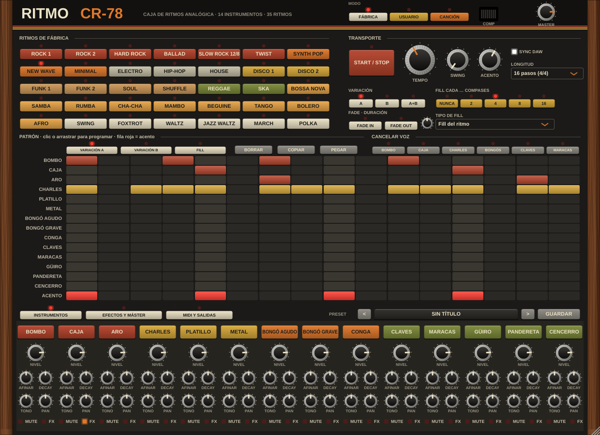
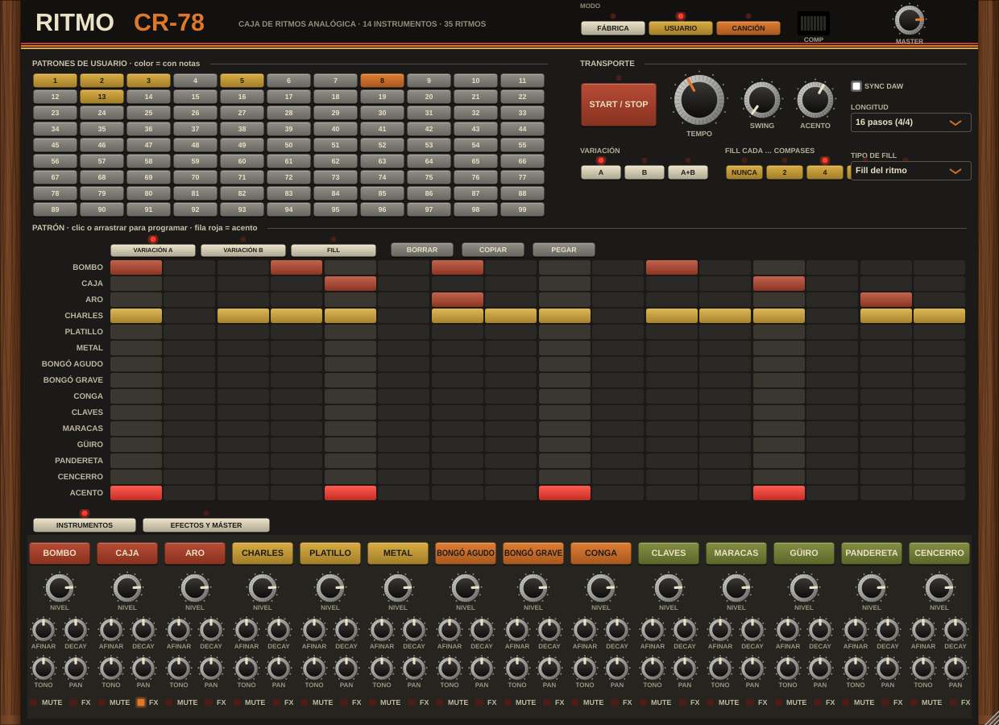
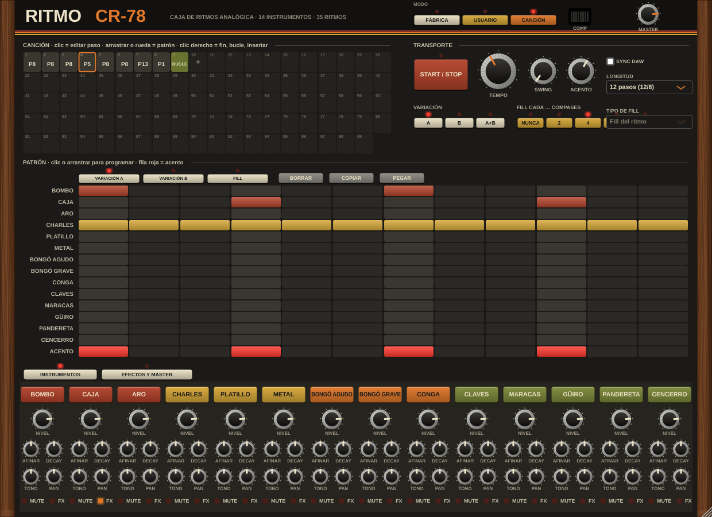
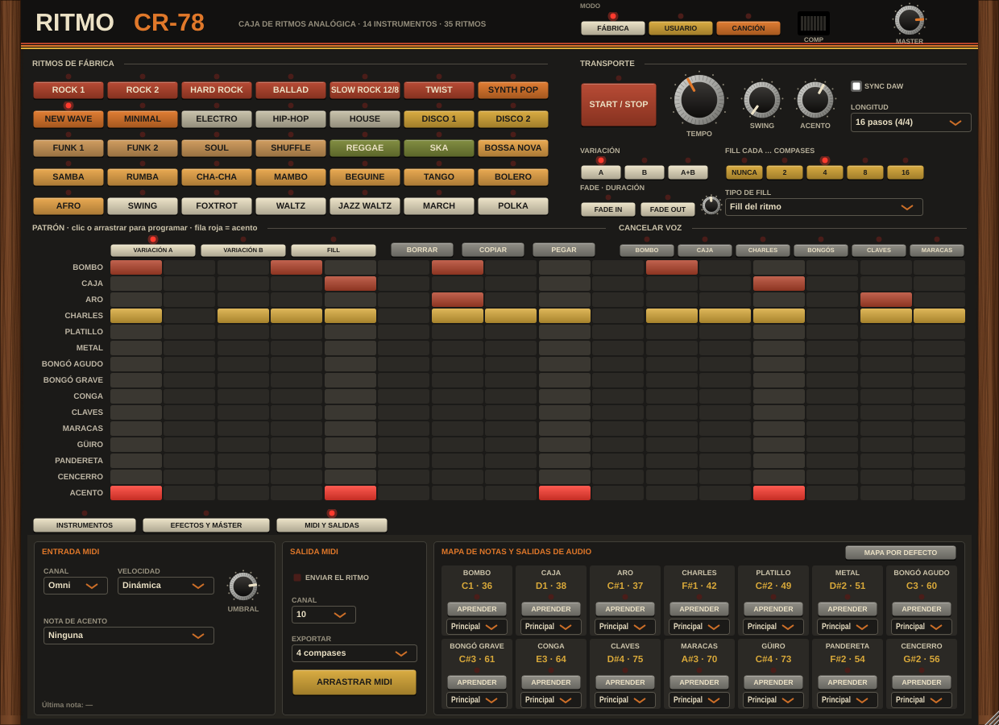

# Ritmo CR-78



Caja de ritmos de estilo analógico de finales de los 70, con diseño, nombre, sonidos y patrones originales.
Formatos: VST3, AU (macOS) y app standalone. Plataformas: macOS 10.13+ (Intel y Apple Silicon) y Windows 10+.

## Compilar

Requisitos: CMake 3.22+, y Xcode (macOS) o Visual Studio 2022 (Windows).

```bash
cmake -B build -DCMAKE_BUILD_TYPE=Release
cmake --build build --config Release --parallel
```

Los binarios quedan en `build/RitmoCR78_artefacts/Release/` (carpetas `VST3`, `AU`, `Standalone`).
Para instalar el plugin en macOS copia `Ritmo CR-78.vst3` a `~/Library/Audio/Plug-Ins/VST3/` y `Ritmo CR-78.component` a `~/Library/Audio/Plug-Ins/Components/`.
En Windows copia `Ritmo CR-78.vst3` a `C:\Program Files\Common Files\VST3\`.

## Hoja de ruta

1. Esqueleto + CI (hecho)
2. Voces sintetizadas (hecho)
3. Secuenciador y ritmos (hecho)
4. Mezclador y efectos (hecho)
5. Interfaz gráfica (hecho)
6. MIDI, salidas múltiples y presets

## Instrumentos (fase 2)

14 voces sintetizadas, sin samples, cada una con Nivel, Afinación (±12 st), Decay, Tono, Pan y Mute:

| Instrumento | Nota MIDI | Síntesis |
|---|---|---|
| Bombo | 36 | senoide percutida con caída de tono y clic |
| Aro | 37 | dos senoides cortas saturadas |
| Caja | 38 | dos senoides + ruido filtrado (bordón) |
| Charles | 42 | banco metálico + ruido, paso alto |
| Platillo | 49 | banco metálico + ruido, decay largo |
| Metal | 51 | banco metálico, banda media |
| Pandereta | 54 | ruido modulado por banco metálico |
| Cencerro | 56 | dos cuadradas filtradas, envolvente doble |
| Bongó agudo / grave | 60 / 61 | senoide percutida |
| Conga | 64 | senoide percutida con caída de tono |
| Maracas | 70 | ráfaga de ruido agudo |
| Güiro | 73 | ruido en banda con raspado |
| Claves | 75 | senoide aguda muy corta |

Velocidad MIDI > 100 = acento. En la interfaz, Mayús+clic en un pad = acento.

`render_demo <carpeta>` genera `01_instrumentos.wav` y `02_ritmo_demo.wav` para escuchar las voces sin DAW.

## Secuenciador (fase 3)

- Patrones de 8, 9, 12, 16, 24 o 32 pasos, en semicorcheas o en tresillos (12/8, swing).
- Tres variaciones por ritmo: **A**, **B** y **Fill**. Modo A, B o A+B alternando por compás, y fill automático cada 2, 4, 8 o 16 compases.
- Fila de acentos por paso, con control de intensidad del acento.
- Swing del 50 % (recto) al 75 %.
- 35 ritmos de fábrica de programación propia: rock, balada, slow rock, twist, synth pop, new wave, minimal, electro, hip-hop, house, disco, funk, soul, shuffle, reggae, ska, bossa nova, samba, rumba, cha-cha, mambo, beguine, tango, bolero, afro, swing, foxtrot, vals, vals de jazz, marcha y polka.
- En el DAW se sincroniza con el transporte (opción *Sync DAW*); en la app standalone usa su propio tempo y el botón PLAY.
- El patrón editado se guarda con la sesión del DAW.

Pruebas: `ctest --test-dir build -C Release`.

## Mezclador y efectos (fase 4)

- Cada instrumento tiene un botón **FX** que lo envía a la cadena de efectos; el resto suena seco.
- Cadena de envío: **Overdrive** (drive, tono, mezcla) → **Flanger** estéreo (velocidad, profundidad, realimentación, mezcla) → **Delay** sincronizado al tempo (1/16 a 1/2, tresillo y puntillo, realimentación, amortiguación, ping-pong) → **Reverb con gate** (tamaño, tiempo de gate, mezcla).
- Máster: **compresor** con rodilla suave y medidor de reducción, y **EQ gráfico de 6 bandas** (60, 150, 400, 1k, 3k y 8k Hz, ±12 dB).
- Todo es automatizable desde el DAW.

## Interfaz (fase 5)

Diseño propio de aire setentero, dibujado por código: laterales de madera, panel negro mate, teclas crema y de colores con LED, mandos con faldón metálico.

- **Ritmos**: 35 teclas con LED, coloreadas por estilo.
- **Transporte**: Start/Stop, tempo, swing, acento, variación A/B/A+B, fill cada N compases, longitud del patrón y Sync DAW.
- **Patrón**: rejilla con pestañas A, B y Fill; cada fila con el color de su instrumento y la fila roja de acentos.
- **Instrumentos**: pad de escucha, nivel, afinación, decay, tono, pan, mute y envío FX.
- **Efectos y máster**: bloques con encendido por LED, compresor con medidor y EQ con faders.
- La ventana se puede redimensionar del 50 % al 200 % manteniendo la proporción.

Captura sin ventana para documentación: `cmake -B build -DR78_UI_SNAPSHOT=ON && cmake --build build --target ui_snapshot`.

## Patrones de usuario y canción (fase 6)

Las teclas **MODO** de la cabecera eligen qué toca la caja:

- **Fábrica**: los 35 ritmos. Puedes retocarlos, pero los cambios se pierden al elegir otro ritmo.
- **Usuario**: 99 patrones propios (teclas 1–99; mostaza = tiene notas, naranja = el seleccionado). Se guardan con el proyecto del DAW.
- **Canción**: hasta 99 pasos que encadenan patrones de usuario. Clic en un paso para editar su patrón en la rejilla, arrastrar o rueda para cambiar el número, clic en «+» para añadir y clic derecho para Fin (para la reproducción), Bucle (vuelve al principio), Insertar, Eliminar o Vaciar.

Con la caja en marcha en modo Usuario o Canción, los pads graban en tiempo real en el paso más cercano de la variación que estés viendo.
**Copiar** y **Pegar** copian el patrón entero (A, B, Fill y longitud): así se pasa un ritmo de fábrica a un patrón de usuario. Clic derecho en el nombre de una fila copia, pega o borra esa fila.




## Cancelar voz y fade (fase 6)

- **Cancelar voz**: seis teclas encima de la rejilla quitan del ritmo un grupo de instrumentos sin borrar el patrón: bombo · caja y aro · charles, platillo y metal · bongós y conga · claves y cencerro · maracas, güiro y pandereta. Las filas canceladas se ven atenuadas. Los pads y las notas MIDI siguen sonando. Cada tecla es un parámetro automatizable.
- **Fade in / Fade out**: suben o bajan el volumen en el tiempo del mando de duración (1–30 s). Fade in con la caja parada la arranca desde silencio; el fade out la para al llegar a cero.

## MIDI (fase 6)

Página **MIDI** (pestaña junto a Efectos y máster):

- **Entrada**: canal (Omni o 1–16) y modo de velocidad. *Dinámica*: el volumen sigue a la velocidad y hay acento por encima del umbral. *Dos niveles*: normal o acento, como el secuenciador. *Fija*: siempre igual. La **nota de acento** acentúa los golpes mientras está pulsada o si llega a la vez, y no dispara ningún instrumento.
- **Mapa de notas**: cada instrumento tiene su nota (por defecto, General MIDI). Pulsa **Aprender** y toca una nota para asignarla; si otro instrumento la tenía, se intercambian. El mapa se guarda con el proyecto.
- **Salida**: con *Enviar el ritmo* activo, cada golpe del secuenciador y de los pads sale como nota MIDI (acento = velocidad 127, normal = 90) por el canal elegido (10 por defecto). En la app standalone va al puerto MIDI elegido en Opciones.



## Multisalida y exportar MIDI (fase 6)

- **Salidas de audio**: además de la principal, el plugin ofrece 7 salidas estéreo extra (Salida 2 a 8). En la página *MIDI y salidas* eliges la salida de cada instrumento. Las extra van en seco (sin efectos ni compresor/EQ, sí con master y fade) para procesarlas en el DAW. Hay que activarlas en el DAW; si una salida está desactivada, el instrumento vuelve a la principal.
- **Arrastrar MIDI**: elige cuántos compases (1–16) y arrastra la tecla a una pista del DAW o al escritorio. Exporta lo que sonaría: variación, fills, swing, Cancelar voz y el mapa de notas. En modo canción exporta una pasada de la canción.
